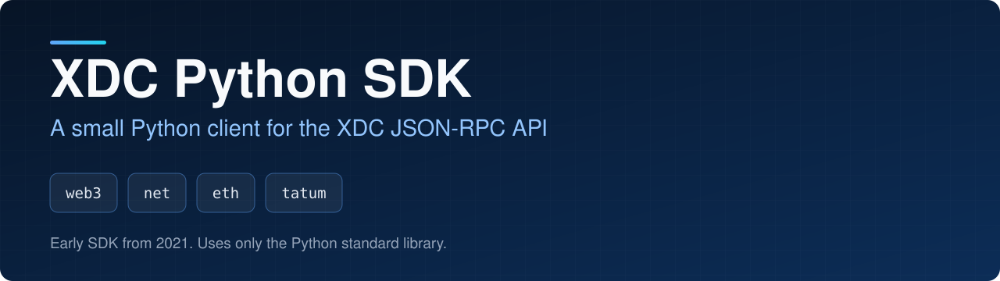
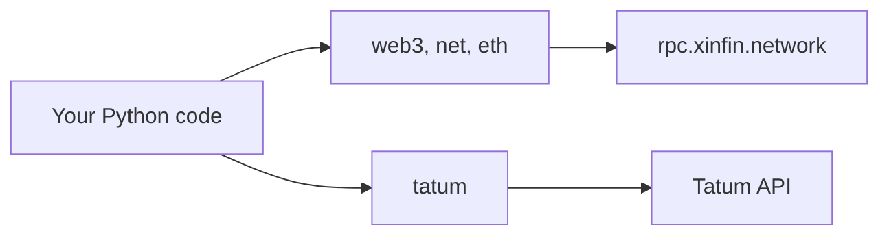

<p align="center">
  
</p>

<p align="center">
  
<a href="https://github.com/CoinClubQuincy/XDC_Python_SDK_V1/actions/workflows/build.yml"></a>        
</p>

<p align="center">
  <a href="#quick-start">Quick start</a> · <a href="#what-is-included">What is included</a> · <a href="#what-is-tested">What is tested</a> · <a href="#known-issues">Known issues</a>
</p>

This is a lightweight Python wrapper for the XDC JSON-RPC API. It needs no third-party packages, and each method returns JSON by default or a plain value with `form="Text"`.

> [!NOTE]
> This is an early SDK. For new projects, also look at [CoinClub_Framework](https://github.com/CoinClubQuincy/CoinClub_Framework), which has an XDC adapter, wallets and tests.

## Quick start

```bash
git clone https://github.com/CoinClubQuincy/XDC_Python_SDK_V1.git
cd XDC_Python_SDK_V1
python3 -m unittest discover -s tests
```

```python
from eth import eth_Request
from net import net_Request

print(net_Request.version(form="Text"))
print(int(eth_Request.gasPrice(form="Text"), 16))
print(eth_Request.getBalance(form="Text", Address="0xYourAddress"))
```

Hexadecimal results need converting, as in the second line. Run this from the repository folder: the local `web3.py` would otherwise be confused with the popular `web3` package.

Failures raise an exception instead of returning an empty value: `RPCError` when the node refuses a call, and `APIError` when the connection fails, the server returns anything other than a 2xx status or the reply is unreadable. This applies to both forms. A missing input raises `ValueError` before anything is sent.

## What is included



| Module | Methods | Covers |
| --- | --- | --- |
| [`web3.py`](web3.py) | 2 | `clientVersion`, `sha3` |
| [`net.py`](net.py) | 3 | `version`, `listening`, `peerCount` |
| [`eth.py`](eth.py) | 29 | Blocks, transactions, accounts, gas and sync state |
| [`tatum.py`](tatum.py) | 13 | Wallets, balances and transfers through the [Tatum](https://tatum.io) API |

The full reference is in [docs/API.md](docs/API.md).

### Using Tatum

Each Tatum method takes your API key. `EXECUTE_Test.py` makes read-only checks against the live services, and needs nothing but the choice of service for the public node:

```bash
python3 EXECUTE_Test.py rpc

export TATUM_API_KEY="your-key"
export TATUM_ADDRESS="your-address"
python3 EXECUTE_Test.py tatum
```

> [!WARNING]
> `Generate_XDC_Wallet` and `Generate_XDC_Private_key` send your seed phrase to Tatum, and the first puts it in the URL. `Send_XDC_ERC20` and `Execute_Smart_Contract` can send your private key. Tatum can read whatever you send, so use these only with test wallets, and sign locally for anything of value.

## What is tested

[`tests/test_sdk.py`](tests/test_sdk.py) has 44 tests and runs in CI on every push. They use a local mock server and make no outside network calls.

| Tested | Not tested |
| --- | --- |
| All 29 `eth` methods, plus `net` and `web3`, sending the method and inputs they were given | `sign`, `sendTransaction` and `sendRawTransaction` against a live node |
| Required inputs refused before anything is sent | Any Tatum call against the real Tatum service |
| Node errors, HTTP errors, unreadable replies and connection failures | `web3.sha3` against a live node |
| Tatum paths, payloads, URL encoding and the API key header | |
| The API key staying out of error messages | |
| Connections closing, and no connection being opened at import | |

On 2 November 2026, the read-only methods were also run against `rpc.xinfin.network`: 26 of the 29 `eth` methods, all of `net` and `web3.clientVersion`. They returned valid replies, and the transaction lookups found the transaction they asked for. That first run also found a real bug the mock server couldn't: the node returned HTTP 403 until requests carried a `User-Agent`. This check is manual and isn't part of CI.

## Changes from earlier versions

These change how existing code calls the SDK.

- Almost every `eth` method ignored its inputs and sent a fixed sample value, so `getBalance` always read the same address. Methods now send what you pass them.
- `sendTransaction` sent a fixed example transaction, and `sign` sent `eth_accounts`. Both now do what their names say. `web3.clientVersion` sent `net_version`, and now sends `web3_clientVersion`.
- `eth` inputs have new names: see [docs/API.md](docs/API.md). `accounts` no longer takes an argument.
- `Send_XDC_ERC20` had a private key hard-coded in its payload. It now uses only the key you pass, and the other Tatum methods no longer send fixed sample values.
- Importing the SDK no longer opens a connection. Each call opens and closes its own unless you pass `conn`, and connections have a 30-second timeout.
- Failures now raise exceptions, including an error reply when the raw response was asked for.
- Requests now send a `User-Agent`, because the public node refused them without one.
- `EXECUTE_Test.py` no longer prints a private key or uses a seed. It takes `rpc` or `tatum` as an argument.

## Known issues

| Issue | Effect |
| --- | --- |
| The local `web3.py` shares a name with the popular `web3` package | Importing from this folder hides that package |
| `sign` and `sendTransaction` act for accounts held by the node | They can't use your own wallet. Sign elsewhere and use `sendRawTransaction` |
| `Generate_XDC_Wallet` puts the seed in the URL | That is Tatum's URL format, and the seed can end up in logs. Never use a seed that holds real funds |
| `Web3_HTTP_Driver` puts the API key in the URL | That is Tatum's URL format, and the key can end up in logs |
| Nothing signs transactions locally | The SDK has no signing code of its own |

<details>
<summary><strong>More XDC and EVM projects</strong></summary>

| Group | Project | What it is |
| --- | --- | --- |
| Standards | [XRC-SHARES](https://github.com/CoinClubQuincy/XRC-SHARES) | Dividend-paying NFT shares and SPLITS for a DApp |
| Standards | [XRCDividendPlus](https://github.com/CoinClubQuincy/XRCDividendPlus) | Dividend-paying XRC-20 token |
| Treasury and finance | [Multi-Sig-Treasury](https://github.com/CoinClubQuincy/Multi-Sig-Treasury) | Treasury controlled by tokenized keys |
| Treasury and finance | [XRC-Airdrop](https://github.com/CoinClubQuincy/XRC-Airdrop) | Self-run token airdrop |
| Treasury and finance | [XRC-Credit](https://github.com/CoinClubQuincy/XRC-Credit) | Single-loan credit contract |
| Treasury and finance | [XDC-Defi-Instruments](https://github.com/CoinClubQuincy/XDC-Defi-Instruments) | Assets, agreements, forwards, futures and a marketplace |
| Treasury and finance | [XRC1155-Equities-Market](https://github.com/CoinClubQuincy/XRC1155-Equities-Market) | Shares, portfolios and a marketplace on ERC-1155 |
| Treasury and finance | [NFTOTC](https://github.com/CoinClubQuincy/NFTOTC) | Over-the-counter sale of a token collection |
| Treasury and finance | [DAppProxySwap](https://github.com/CoinClubQuincy/DAppProxySwap) | Currency swaps for a DApp through a fixed router |
| Identity and access | [LoginMFAContract](https://github.com/CoinClubQuincy/LoginMFAContract) | Login with an NFT and a signed second factor |
| Identity and access | [PrivateAccessToken](https://github.com/CoinClubQuincy/PrivateAccessToken) | Token access to encrypted off-chain data |
| Identity and access | [Delegated_Authority](https://github.com/CoinClubQuincy/Delegated_Authority) | KYC notary proof of concept |
| Identity and access | [EncryptedNFT-Documents](https://github.com/CoinClubQuincy/EncryptedNFT-Documents) | NFTs tied to encrypted off-chain documents |
| Learning and libraries | [XDC-LemonadeStand](https://github.com/CoinClubQuincy/XDC-LemonadeStand) | Workshop DApp built on XRC-SHARES |
| Learning and libraries | [Non-Financial-SmartContracts](https://github.com/CoinClubQuincy/Non-Financial-SmartContracts) | Games, inventory, keys and on-chain repositories |
| Learning and libraries | [ContractLedger](https://github.com/CoinClubQuincy/ContractLedger) | On-chain list of contract addresses |
| Learning and libraries | [TimestampConverter](https://github.com/CoinClubQuincy/TimestampConverter) | Timestamps to calendar dates in Solidity |
| Tools | [PrivateXDCNode_SetupScript](https://github.com/CoinClubQuincy/PrivateXDCNode_SetupScript) | Private XDC network setup scripts |
| Tools | [WebApp_to_XDCPay](https://github.com/CoinClubQuincy/WebApp_to_XDCPay) | Working web app connected to XDCPay |
| Multi-chain | [CoinClub_Framework](https://github.com/CoinClubQuincy/CoinClub_Framework) | Python library with an XDC adapter |
| Interfaces | [Contract_Interface_Model_Language](https://github.com/CoinClubQuincy/Contract_Interface_Model_Language) | Interface documents for smart contracts and APIs |

</details>

## License

[MIT](LICENSE).
