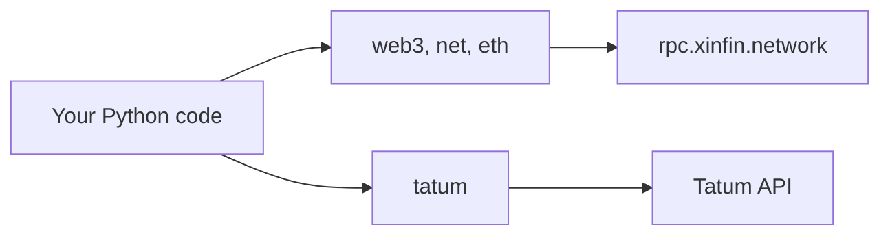

<p align="center">
  
</p>

<p align="center">
  
<a href="https://github.com/CoinClubQuincy/XDC_Python_SDK_V1/actions/workflows/build.yml"></a>        
</p>

<p align="center">
  <a href="#quick-start">Quick start</a> · <a href="#what-is-included">What is included</a> · <a href="#what-is-tested">What is tested</a>
</p>

This is a lightweight Python wrapper for the XDC JSON-RPC API. It needs no third-party packages, and each method returns JSON by default or a plain value with `form="Text"`.

> [!NOTE]
> This is an early SDK. For new projects, also look at [CoinClub_Framework](https://github.com/CoinClubQuincy/CoinClub_Framework), which has an XDC adapter, wallets and tests.

## Quick start

```bash
git clone https://github.com/CoinClubQuincy/XDC_Python_SDK_V1.git
cd XDC_Python_SDK_V1
```

```python
from net import net_Request
from eth import eth_Request

print(net_Request.version(form="Text"))
print(int(eth_Request.gasPrice(form="Text"), 16))
```

Hexadecimal results need converting, as in the second line. Run this from the repository folder: the local `web3.py` would otherwise be confused with the popular `web3` package.

## What is included



| Module | Methods | Covers |
| --- | --- | --- |
| [`web3.py`](web3.py) | 2 | `clientVersion`, `sha3` |
| [`net.py`](net.py) | 3 | `version`, `listening`, `peerCount` |
| [`eth.py`](eth.py) | 29 | Blocks, transactions, accounts, gas and sync state |
| [`tatum.py`](tatum.py) | 13 | Wallets, balances and transfers through the [Tatum](https://tatum.io) API |

The full reference is in [docs/API.md](docs/API.md).

### Using Tatum

`EXECUTE_Test.py` reads its credentials from the environment and sends requests to Tatum:

```bash
export TATUM_API_KEY="your-key"
export TATUM_SEED="your-test-seed"
python3 EXECUTE_Test.py
```

## What is tested

CI checks that every Python file parses. **The SDK's calls were not run in this review**, and the repository has no real test suite. The XDC mainnet RPC it uses, `rpc.xinfin.network`, did answer a separate check with chain ID 50.

<details>
<summary><strong>More XDC projects</strong></summary>

| Group | Project | What it is |
| --- | --- | --- |
| Standards | [XRC-SHARES](https://github.com/CoinClubQuincy/XRC-SHARES) | Dividend-paying NFT shares and SPLITS for a DApp |
| Standards | [XRCDividendPlus](https://github.com/CoinClubQuincy/XRCDividendPlus) | Dividend-paying XRC-20 token |
| Treasury and finance | [Multi-Sig-Treasury](https://github.com/CoinClubQuincy/Multi-Sig-Treasury) | Treasury controlled by tokenized keys |
| Treasury and finance | [XRC-Airdrop](https://github.com/CoinClubQuincy/XRC-Airdrop) | Self-run token airdrop |
| Treasury and finance | [XRC-Credit](https://github.com/CoinClubQuincy/XRC-Credit) | Debt contract skeleton |
| Treasury and finance | [XDC-Defi-Instruments](https://github.com/CoinClubQuincy/XDC-Defi-Instruments) | Assets, agreements, forwards, futures and a marketplace |
| Identity and access | [LoginMFAContract](https://github.com/CoinClubQuincy/LoginMFAContract) | Login with a password and an NFT |
| Identity and access | [PrivateAccessToken](https://github.com/CoinClubQuincy/PrivateAccessToken) | Token-gated contract data demo |
| Identity and access | [Delegated_Authority](https://github.com/CoinClubQuincy/Delegated_Authority) | KYC notary proof of concept |
| Learning and libraries | [XDC-LemonadeStand](https://github.com/CoinClubQuincy/XDC-LemonadeStand) | Workshop DApp built on XRC-SHARES |
| Learning and libraries | [Non-Financial-SmartContracts](https://github.com/CoinClubQuincy/Non-Financial-SmartContracts) | Games, inventory, keys and on-chain repositories |
| Tools | [PrivateXDCNode_SetupScript](https://github.com/CoinClubQuincy/PrivateXDCNode_SetupScript) | Private XDC network setup scripts |
| Tools | [WebApp_to_XDCPay](https://github.com/CoinClubQuincy/WebApp_to_XDCPay) | Web app to XDCPay tutorial |
| Multi-chain | [CoinClub_Framework](https://github.com/CoinClubQuincy/CoinClub_Framework) | Python library with an XDC adapter |
| Interfaces | [Contract_Interface_Model_Language](https://github.com/CoinClubQuincy/Contract_Interface_Model_Language) | Interface documents for smart contracts and APIs |

</details>

## License

This repository has no license file yet, so default copyright applies.
